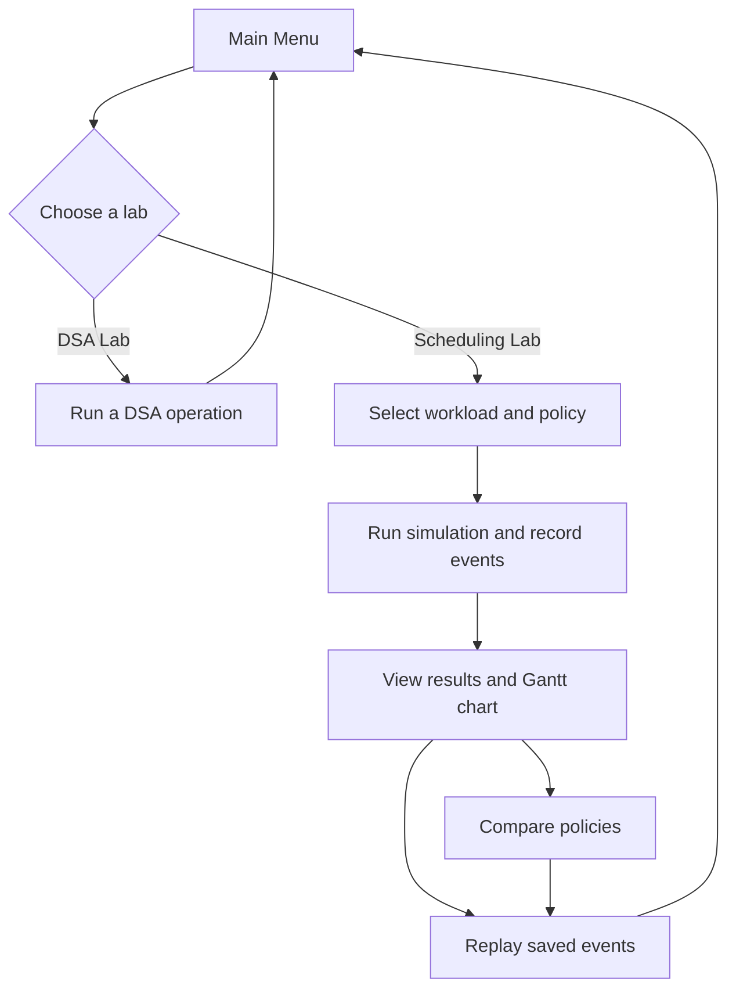

# CPU Process and Task Scheduling Simulator

A terminal based C++17 project for exploring how operating systems schedule processes. The planned application will accept process IDs (PIDs), arrival times, burst times, and priorities; run FCFS, Round Robin, and Priority Scheduling; and report execution order and scheduling metrics. A separate DSA Lab will demonstrate the required data structures and algorithms that do not naturally belong inside the scheduler.

This README is the project overview and five day development plan. The architecture and features below are proposed. They are not claims that the application has been implemented.

## 1. Project Objectives

- Model processes with a PID, arrival time, burst time, and priority.
- Implement three scheduling policies with clear and repeatable ordering rules.
- Show process execution, state changes, ready queue, and a Gantt chart in the terminal.
- Compare policies against independent copies of the same workload.
- Demonstrate required DSA operations in a DSA Lab, integrating a structure into scheduling only where it is a natural fit.
- Practice modular development, testing, file handling, and team integration within a five day target schedule.

## 2. Planned Features

- **Process management:** add, display, search, update, and delete process records.
- **Scheduling Lab:** run FCFS, Round Robin, or Priority Scheduling on a workload.
- **Round Robin queue:** use an array based circular queue for ready processes.
- **Live terminal view:** show simulated time, running process, ready queue, process states, and a growing ASCII Gantt chart. Animation delay is only for display; it does not advance simulated time.
- **Event log and replay:** record timestamped arrivals, dispatches, preemptions, and completions, then replay saved events without running the scheduler again.
- **Policy comparison:** run each policy on an independent copy of the same workload and compare the resulting metrics.
- **DSA Lab:** exercise required structures and algorithms that are not required by the scheduler.
- **Sequential record storage:** append, display, search, and delete process records in a sequential file.
Planned application flow:



## 3. Mandatory DSA Coverage

The DSA Lab is intended to make each required operation demonstrable from the terminal. A data structure should only be described as part of the scheduler when the implementation actually uses it there.

| Requirement | Planned operations | Relationship to scheduler |
|---|---|---|
| Singly linked list (SLL) | Insert, delete, traverse, search, update node values, reverse | Demonstrated in DSA Lab. The scheduler does not require an SLL. |
| Doubly linked list (DLL) | Insert, delete, traverse in both directions, search, update node values, reverse | Demonstrated in DSA Lab. Could support browsing event history if implemented that way, but that is optional and should only be claimed if used. |
| Array and linked-list stacks | Push, pop, peek/top, display, empty check; full check for bounded array stack | Demonstrated in DSA Lab. No stack is required by the scheduling algorithms. |
| Array and linked-list queues | Enqueue, dequeue, front, display, empty check; full check for bounded array queue | The array based circular queue is used by Round Robin. Other queue variants are demonstrated in DSA Lab. |
| Searching | Linear search and binary search | Demonstrated in DSA Lab and can be used for process lookup. Binary search requires data sorted by the searched key; it must not be applied to an unsorted list. |
| Sorting | Bubble sort, insertion sort, and quick sort in ascending order | Demonstrated in DSA Lab; may sort a display or a copy of process records. Sorting is not itself a scheduling policy. |
| Hash table | Insert and search with open addressing, preferably linear probing | Demonstrated in DSA Lab; may provide PID lookup if the scheduler's process store uses it. It is not required for scheduling. |
| Sequential file handling | Append, display, search, and delete a specific record while retaining sequential access | Supports saving and managing process records. A delete operation may require rewriting retained records to a replacement file. |

For fixed-capacity array structures, operations must report full or empty conditions safely. Define duplicate PID behavior and file record format during implementation.

## 4. Scheduling Algorithms and Rules

The initial design uses the following assumptions:

- **FCFS (First-Come, First-Served):** non-preemptive; among available processes, dispatch the earliest arrival first.
- **Round Robin (RR):** preemptive, with a configurable positive time quantum and an array based circular ready queue. Processes that arrive during a time slice become ready before the running process is re-enqueued at the end of its slice.
- **Priority Scheduling:** initially non-preemptive; a smaller priority number means higher priority.
- Equal arrival times are ordered by PID. Equal priorities are resolved by arrival time and then PID. These rules also make selection deterministic when multiple processes are ready.
- When the ready queue is empty but work remains, the CPU is idle until the next arrival. Idle intervals must appear in the timeline and count toward elapsed time.
- Animation delay must not change simulated time.
- Policy comparisons give each algorithm an independent copy of the same input workload so one run cannot affect another.

A scheduling result should include the execution sequence and per-process completion, turnaround, and waiting times. For Round Robin, the sequence should preserve each run segment, including repeated appearances of the same PID. Define and document behavior for invalid process data, duplicate PIDs, and an invalid time quantum as part of implementation.

## 5. Performance Metrics

For each process:

- **Completion Time (CT):** simulated time at which the process finishes.
- **Turnaround Time (TAT):** `CT - Arrival Time (AT)`.
- **Waiting Time (WT):** `TAT - Burst Time (BT)`.

For a workload with `n` processes:

- **Average Waiting Time:** sum of all waiting times divided by `n`.
- **Average Turnaround Time:** sum of all turnaround times divided by `n`.
- **CPU Utilization:** `Busy CPU Time / Total Elapsed Simulation Time * 100%`.
- **Throughput:** `Number of Completed Processes / Total Elapsed Simulation Time`.

CPU utilization and throughput need a defined measurement interval. The initial proposal is from simulation start (time zero) to the final completion, including CPU idle time. Handle zero processes or zero elapsed time without division by zero; report the metric as not applicable or define another explicit convention. Use the same interval for every policy in a comparison.

## 6. Proposed Architecture

This directory layout is a target for organizing the implementation, not a list of files already present.

```text
.
├── models/       # Process and event definitions
├── dsa/          # Linked lists, stacks, queues, search, sort, and hash table
├── scheduler/    # FCFS, Round Robin, and Priority Scheduling
├── simulation/  # Simulation engine, event logger, and replay engine
├── storage/     # Sequential process record file operations
├── ui/          # Terminal menus, status display, and Gantt chart
├── data/         # Process records and saved simulation history
├── tests/        # Test cases
├── main.cpp      # Application entry point
└── README.md
```

Keep policy logic independent of terminal rendering where practical. The simulation can produce timestamped events and results; the UI can render them live or replay them. File formats and module interfaces should be agreed on before parallel implementation.

## 7. Five-Day Development Roadmap

These are targets for a five day project, not completed milestones.

| Day | Work | Target deliverables |
|---|---|---|
| **1** | Define shared process models and interfaces; implement SLL, DLL, stacks, and queues. | Agreed process model and menu plan; required basic structures and operations available for integration. |
| **2** | Implement searching, sorting, hashing, and sequential file operations. | DSA Lab operations for linear and binary search, three sorts, linear probing, and record storage. |
| **3** | Implement FCFS, Round Robin, Priority Scheduling, metrics, and tie-breaking rules. | Deterministic scheduling results for agreed workloads, including idle gaps and process metrics. |
| **4** | Implement live terminal animation, Gantt charts, policy comparison, timestamped event logging, and basic event replay. | Demonstrable simulation view and replay of recorded events; animation independent of simulated time. |
| **5** | Integrate modules, test every DSA requirement, validate scheduling calculations, fix bugs, and prepare documentation and the final demonstration. | Integrated application, completed checks, corrected issues, and demonstration materials. |

## 8. Prerequisites and Compilation

The planned implementation targets a C++17 compiler, for example GCC, Clang, or a recent Microsoft Visual C++ toolchain. Choose one compiler and record its version and exact build command when the source layout is established.

The workspace structure has not yet been confirmed, so the following is only an example for a single-file starting point, not a guaranteed project build command:

```sh
g++ -std=c++17 -Wall -Wextra -pedantic main.cpp -o scheduler_simulator
```

For a modular implementation, compile and link the actual `.cpp` files or add a build configuration after the team settles the file layout. Do not copy the example command unchanged if the project uses multiple source files or a different entry point.

## 9. How to Run

Once an executable has been built, run the executable produced by the chosen compiler command. For the illustrative single-file command above:

```sh
./scheduler_simulator
```

On Windows, the executable may be named `scheduler_simulator.exe`. The executable name, menu choices, data paths, and run instructions must be updated to match the implementation before release.

## 10. Illustrative Terminal Session

The following session demonstrates the intended interaction only. It is not a screenshot or evidence of an implemented interface, and the values are illustrative.

```text
CPU Process and Task Scheduling Simulator
1. Process Management
2. Scheduling Lab
3. DSA Lab
4. View / Replay Saved Simulation
0. Exit
Select: 2

Scheduling Lab
Processes: P1 (arrival 0, burst 5, priority 2)
           P2 (arrival 1, burst 3, priority 1)
Policy: Round Robin
Time quantum: 2

Time 0 | Running: P1 | Ready: []
Gantt: 0 -- P1 -- 2
Time 2 | Running: P2 | Ready: [P1]
Gantt: 0 -- P1 -- 2 -- P2 -- 4
...

Results (illustrative)
PID  AT  BT  Priority  CT  TAT  WT
P1    0   5      2      8    8    3
P2    1   3      1      7    6    3
```

The illustrative values follow the stated Round Robin ordering: P1 runs at times 0-2 and 4-6, then 7-8; P2 runs at 2-4 and 6-7.

## 11. Testing Strategy and Edge Cases

No test results are claimed here. The team should create checks for each required operation and compare scheduling outputs with hand-calculated examples.

- Empty and single-process workloads; simultaneous arrivals; idle time before the first arrival and between processes.
- Round Robin with a process finishing exactly at a quantum boundary, arrivals during a time slice, multiple ready processes, and invalid or zero quantum.
- Priority ties, arrival ties, duplicate PIDs, and deterministic results across repeated runs.
- Verify `TAT = CT - AT` and `WT = TAT - BT` per process; check averages and utilization against the defined measurement interval.
- Empty/full array structures; deleting the first, middle, last, or only list node; reverse empty, one-node, and multi-node lists.
- Binary search on sorted data, each sort with empty/single/duplicate values, hash collisions and a full table.
- File append, display, search, delete, and behavior for missing or malformed files and records.
- Event replay should reproduce the recorded timeline without invoking a scheduling policy.

## 12. Team Responsibilities and Integration Workflow

Assign these responsibilities to group members according to team size; no individual contributors are specified here.

| Responsibility | Main work |
|---|---|
| DSA module | Linked lists, stacks, queues, search, sorting, and hash table operations. |
| Scheduler module | Scheduling policies, ready queue, deterministic ordering, and metrics. |
| Simulation and storage | Event log, replay, process record files, and persistence behavior. |
| UI and integration | Menus, animation, Gantt chart, module integration, and final walkthrough. |

Agree on shared models, function interfaces, file formats, and ownership before coding. Integrate small working pieces daily, keep a shared list of edge cases, and review the final checklist together. With a smaller group, combine roles while preserving clear module ownership.

## 13. Future Enhancements

Possible extensions after the required scope works include preemptive priority scheduling, configurable process workloads loaded from files, additional scheduling policies, richer event filtering, and a build system or automated test runner. Add enhancements only after required operations and calculations have been validated.

## 14. Current Project Status and Completion Checklist

The supplied workspace currently contains no project source files. This document describes the proposed project; implementation and test status should be updated as work is completed.

- [ ] Shared process and event models implemented.
- [ ] Every listed DSA operation implemented and accessible in the DSA Lab.
- [ ] Round Robin uses an array based circular queue.
- [ ] FCFS, Round Robin, and Priority Scheduling follow documented ordering rules.
- [ ] Metrics, idle intervals, utilization, and throughput are validated.
- [ ] Live view, Gantt chart, timestamped logging, and event replay work.
- [ ] Policy comparison uses independent copies of the same workload.
- [ ] Sequential file operations work for normal and error cases.
- [ ] Build and run instructions match the actual project structure.
- [ ] Tests and final demonstration completed; outcomes documented accurately.
