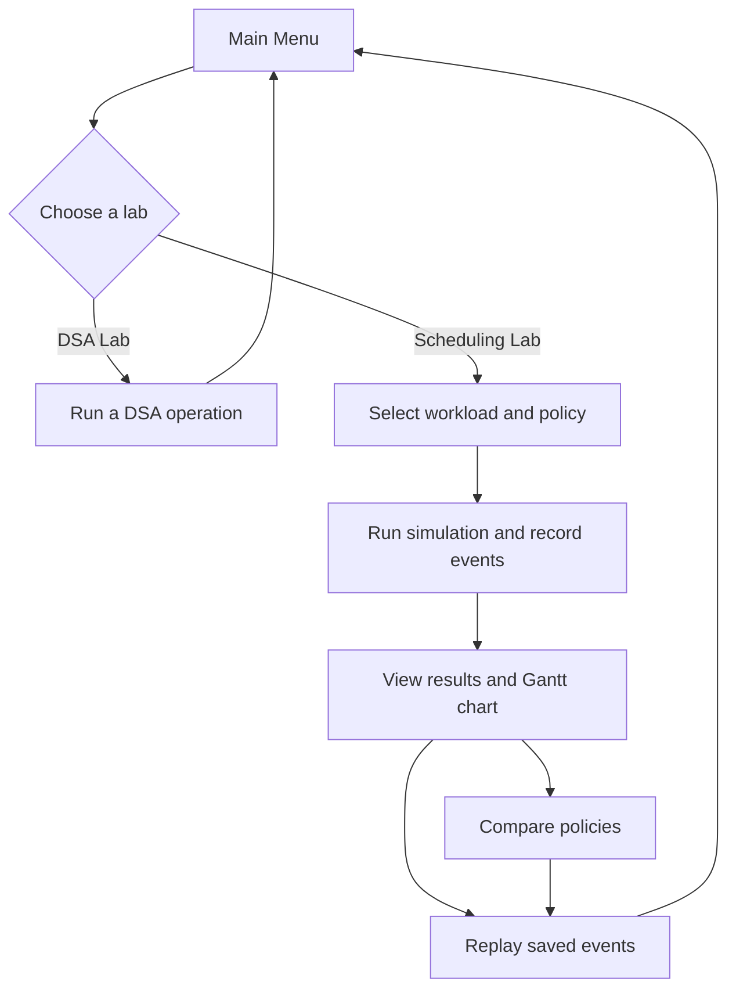

# DOOMSDAY // TEMPORAL CORE

---

**CPU Process & Task Scheduling Simulator**

> "Every process has a timeline. Every decision changes the outcome."

A C++17 CPU scheduling simulator presented under the identity `DOOMSDAY // TEMPORAL CORE`. Its terminal UI is a futuristic temporal command center for monitoring actual process execution. The application accepts process IDs (PIDs), arrival times, burst times, and priorities; runs FCFS, Round Robin, and Priority Scheduling; and reports execution order and scheduling metrics. A separate DSA Lab demonstrates the required data structures and algorithms that do not naturally belong inside the scheduler.

This README contains the project overview, design conventions, five day development plan, and implementation notes. Current project status is summarized at the end.

---

## 1. Project Objectives

- Model processes with a PID, arrival time, burst time, and priority.
- Implement three scheduling policies with clear and repeatable ordering rules.
- Show process execution, state changes, ready queue, and a Gantt chart in the terminal.
- Compare policies against independent copies of the same workload.
- Demonstrate required DSA operations in a DSA Lab, integrating a structure into scheduling only where it is a natural fit.
- Practice modular development, testing, file handling, and team integration within a five day target schedule.

---

## 2. Planned Features

- **Process management:** add, display, search, update, and delete process records.
- **Scheduling Lab:** run FCFS, Round Robin, or Priority Scheduling on a workload.
- **Round Robin queue:** use an array based circular queue for ready processes.
- **Live terminal view:** show simulated time, running process, scheduler-captured ready queue and process states, and a growing ASCII Gantt chart in the temporal command-center presentation. Animation delay is only for display; it does not advance simulated time.
- **Event log and replay:** record timestamped arrivals, dispatches, preemptions, and completions, then replay saved events without running the scheduler again.
- **Policy comparison:** run each policy on an independent copy of the same workload and compare the resulting metrics.
- **DSA Lab:** exercise required structures and algorithms that are not required by the scheduler.
- **Sequential record storage:** append, display, search, and delete process records in a sequential file.
Planned application flow:



---

## DOOMSDAY Terminal UI Theme

The terminal presentation is a futuristic temporal command center monitoring real process execution across a timeline. `DOOMSDAY // TEMPORAL CORE` is the visual identity for this CPU scheduling project; it adds no fictional behavior or scheduling rules. The examples below are illustrative. The final demonstration may introduce the project as `DOOMSDAY // TEMPORAL CORE - CPU Process & Task Scheduling Simulator` and explain the actual operating-system scheduling concepts accurately.

### Visual and terminal conventions

Use compact tables, consistent separators, angular ASCII borders, and restrained decoration. Keep process IDs, times, queue contents, DSA operations, and metrics readable.

| Display color | Use |
|---|---|
| Terminal background | Respect the operator's configured dark terminal theme; do not require a forced background color |
| Green | DOOMSDAY identity, active processes, selected options, successful operations |
| Blue/cyan | Simulated timestamps, system information, timeline markers, ready queue |
| Yellow | Warnings, arriving processes, time-quantum expiration, important transitions |
| Grey | Completed processes and secondary information |
| White/light grey | Main text and table contents |
| Red | Errors, invalid input, critical system alerts |

For process states, green means running, cyan means ready, yellow means newly arrived or awaiting dispatch, grey means completed, and red means invalid data or an error. Use only states already produced by the scheduler; color is presentation and never affects scheduling decisions. Show concise system messages such as `NEW PROCESS DETECTED`, `PROCESS DISPATCHED`, `PROCESS PREEMPTED`, `TIME QUANTUM EXHAUSTED`, `EXECUTION COMPLETE`, and `CPU IDLE // WAITING FOR NEXT ARRIVAL` only when their corresponding real events occur. When work remains and the ready queue is empty, label the interval `TIMELINE GAP // CPU IDLE` and show it in the Gantt chart according to the existing simulated-time rules. Boot checks and loading messages must be clearly marked as presentation-only initialization; they must not imply hardware, scheduler, or workload checks that did not run.

Use ANSI colors and cursor positioning only when supported; provide a readable plain-text fallback for limited terminals. Prefer ASCII borders; Unicode symbols are optional. C++17 facilities such as `<chrono>`, `<thread>`, ANSI escape sequences, and cursor positioning are sufficient. Do not add a graphics library or UI framework solely for this theme.

### Animated terminal behavior

The terminal renders actual application events and results with these behaviors. They do not add scheduling rules.

1. **Boot sequence:** reveal the application title, show visual interface-readiness messages, and animate a short loading bar before the main menu. Label these messages as presentation-only; do not report system checks that have not actually run.
2. **Menu reveal:** reveal menu sections progressively, then highlight the operator's selected option using the green identity color.
3. **Live scheduling:** grow the ASCII Gantt chart as actual execution segments occur. Use the palette to highlight recorded arrivals, dispatches, preemptions, completions, and idle intervals.
4. **Process transitions:** briefly highlight a process when its scheduler-produced state changes. Use green for running, cyan for ready, yellow for arrivals and important transitions, and grey for completed processes.
5. **Timeline replay:** progressively render saved events without invoking the scheduling policy. Provide feasible pause, resume, and playback-speed controls; replay must preserve the recorded event order and timestamps.
6. **Results presentation:** reveal the execution report in readable stages, followed by per-process and aggregate metrics, rather than dumping an unformatted block.

Provide configurable animation speed and an option to skip or minimize animation. In plain-text mode, show the same actual events, segments, and metrics without color or cursor effects. Display delays and playback controls affect rendering only; they must never change simulated CPU time, arrivals, queue ordering, scheduling decisions, execution segments, calculated metrics, event timestamps, or replay semantics.

### Command-center main menu

These main-menu labels map to existing features; they do not add modules or change application flow.

| Display label | Existing feature |
|---|---|
| Process Registry | Process Management |
| Temporal Simulation | Scheduling Lab |
| DSA Training Chamber | DSA Lab |
| Timeline Archives | Saved Simulations, Event Logs, and Replay |
| Multiverse Comparison | Scheduling Policy Comparison |
| System Configuration | Animation and color settings |
| Shut Down Core | Exit |

Illustrative main-menu mockup:

```text
+----------------------------------------------------------+
|                 DOOMSDAY // TEMPORAL CORE                |
|              CPU Process & Task Scheduling Simulator     |
|----------------------------------------------------------|
|  TEMPORAL MONITORING SYSTEM                    C++17     |
|  CORE STATUS: ONLINE                                     |
+----------------------------------------------------------+
|  SELECT OPERATION                                        |
|  [01] Process Registry                                   |
|       Process Management                                 |
|  [02] Temporal Simulation                                |
|       FCFS / Round Robin / Priority Scheduling           |
|  [03] DSA Training Chamber                               |
|       Data Structures and Algorithms                    |
|  [04] Timeline Archives                                  |
|       Saved Events and Simulation Replay                 |
|  [05] Multiverse Comparison                              |
|       Compare Scheduling Policies                       |
|  [06] System Configuration                              |
|       Animation and color settings                     |
|  [00] Shut Down Core                                     |
+----------------------------------------------------------+
|  SYSTEM: Awaiting operator command...                    |
+----------------------------------------------------------+
```

### Temporal simulation and algorithm panels

The live scheduling screen shows the selected policy, simulated time, current CPU process, scheduler-captured ready queue, remaining burst time, process states, a growing Gantt chart, timestamped event messages, and simulation status. Every Gantt segment and transition message comes from an actual scheduler result or event; repeated Round Robin runs of the same PID stay visible. Presentation-only initialization messages are identified as such.

```text
+----------------------------------------------------------+
| DOOMSDAY // TEMPORAL CORE                              |
| TEMPORAL SIMULATION                  STATUS: RUNNING   |
+----------------------------------------------------------+
| PROTOCOL: ROUND ROBIN      SIMULATED TIME: T+03          |
| ACTIVE: P2 (2 remaining)   READY QUEUE: [P1]             |
+----------------------------------------------------------+
| TIMELINE TRACE                                           |
|  [ P1 ] [ P2 ]                                           |
|    0      2      3                                      |
+----------------------------------------------------------+
| TEMPORAL EVENT LOG                                       |
| [T=0] P1 dispatched to CPU                               |
| [T=2] P1 time slice expired                              |
| [T=2] P2 dispatched to CPU                               |
| [T=3] P2 is executing // active segment status            |
+----------------------------------------------------------+
```

All values above are illustrative. The existing policy names remain prominent, with optional subtitles: FCFS - `CHRONOLOGICAL PROTOCOL`; Round Robin - `TEMPORAL ROTATION`; Priority Scheduling - `THREAT ASSESSMENT PROTOCOL`. Show the Round Robin quantum, actual ready-queue rotation, preemption, and re-enqueueing. Highlight the selected process's priority for Priority Scheduling. These labels do not change non-preemptive FCFS, Round Robin arrival/requeue order, non-preemptive Priority Scheduling, smaller-number-is-higher priority, tie-breaking, or idle-time behavior documented below.

### Timeline Archives and Multiverse Comparison

The archive shows a run identifier, policy, workload, applicable time quantum, timestamped arrivals/dispatches/preemptions/completions, recorded timeline, final metrics, and replay controls. Replay progressively renders saved events without running the scheduling policy again; step-controlled replay supports pause/resume, exit, and speed adjustment, all of which affect only display. New archive records add metadata and metrics while remaining readable alongside older event-log entries.

```text
+----------------------------------------------------------+
| DOOMSDAY // TEMPORAL CORE // TIMELINE ARCHIVES           |
| RUN: TC-001     POLICY: ROUND ROBIN     QUANTUM: 2       |
| WORKLOAD: P1, P2                                         |
| [T=0] P1 arrived and dispatched                          |
| [T=2] P1 preempted; P2 dispatched                        |
| [T=7] P2 completed                                       |
| FINAL METRICS: see recorded execution report             |
| [1] View recorded timeline   [2] Replay   [0] Return     |
+----------------------------------------------------------+
```

Run IDs, event text, and values here are illustrative. Replay controls render the recorded events only; they do not invoke the scheduling policy again. Replay animation must preserve the recorded order and timestamps.

The comparison panel presents the same workload run on independent copies and displays actual results for the existing policies:

```text
+----------------------------------------------------------+
| DOOMSDAY // TEMPORAL CORE // MULTIVERSE COMPARISON       |
+----------------------------------------------------------+
| Metric                FCFS       RR       PRIORITY       |
| Avg Waiting Time       ...       ...         ...         |
| Avg Turnaround Time    ...       ...         ...         |
| CPU Utilization        ...       ...         ...         |
| Throughput             ...       ...         ...         |
+----------------------------------------------------------+
```

Ellipses are placeholders, not output values. Optional timeline bars must also come from actual simulation results. Keep all metric formulas and measurement intervals unchanged.

### Process Registry, DSA chamber, and results

The Process Registry retains add, display, search, update, and delete. Show PID, arrival time, burst time, and priority in aligned tables. Messages such as `PROCESS REGISTERED`, `PROCESS RECORD UPDATED`, `PROCESS REMOVED FROM REGISTRY`, and `PROCESS NOT FOUND` must reflect the actual operation result. Do not change PID uniqueness, validation, storage, or search behavior.

```text
+----------------------------------------------------------+
| DOOMSDAY // TEMPORAL CORE // PROCESS REGISTRY            |
| PID       ARRIVAL       BURST       PRIORITY             |
| P1        0             5           2                    |
| P2        1             3           1                    |
| SYSTEM: PROCESS REGISTERED                               |
+----------------------------------------------------------+
```

The records and system message are illustrative.

The DSA Training Chamber keeps its conventional terms visible, with optional display names:

| Conventional concept | Optional display name |
|---|---|
| Singly Linked List | Process Chain Inspector |
| Doubly Linked List | Bidirectional Process Chain |
| Array and Linked-List Stacks | Temporal Event Stack |
| Circular Queue | Round-Robin Rotation Monitor |
| Searching | Process Locator |
| Sorting | Workload Ordering Console |
| Hash Table | PID Lookup Index |
| Sequential File Handling | Process Record Archive |

Keep every required DSA operation and preserve the separation between the DSA Lab and Scheduling Lab. Describe a structure as part of scheduling only when the implementation actually uses it.

Present process results with aligned columns for Completion Time (CT), Turnaround Time (TAT), and Waiting Time (WT), plus Average Waiting Time, Average Turnaround Time, CPU Utilization, and Throughput. Labels such as `EXECUTION REPORT`, `TIMELINE SUMMARY`, and `CORE PERFORMANCE METRICS` are presentation only; retain the existing formulas and zero-workload conventions.

Present these results in stages with an optional brief delay between sections. Skipping or minimizing the presentation must reveal the same final values.

### Rendering guidance

Reusable UI helpers render the banner, headings, menus, status indicators, process tables, ready queue, Gantt chart, timestamped event log, results, and comparisons. Keep rendering separate from scheduling-policy logic where practical: the simulation engine produces events and state snapshots, while the UI renders live execution or replay. Animation controls and delays operate only on rendering. Use C++17-compatible terminal output and no unnecessary dependencies.

---

## 3. Mandatory DSA Coverage

The DSA Lab is intended to make each required operation demonstrable from the terminal. A data structure should only be described as part of the scheduler when the implementation actually uses it there.

| Requirement | Planned operations | Relationship to scheduler |
|---|---|---|
| Singly linked list (SLL) | Insert, delete, traverse, search, update node values, reverse | Demonstrated in DSA Lab. The scheduler does not require an SLL. |
| Doubly linked list (DLL) | Insert, delete, traverse in both directions, search, update node values, reverse | Demonstrated in DSA Lab. Could support browsing event history if implemented that way, but that is optional and should only be claimed if used. |
| Array and linked-list stacks | Push, pop, peek/top, display, empty check; full check for bounded array stack | Demonstrated in DSA Lab. No stack is required by the scheduling algorithms. |
| Array and linked-list queues | Enqueue, dequeue, front, display, empty check; full check for bounded array queue | The array based circular queue is used by Round Robin. Other queue variants are demonstrated in DSA Lab. |
| Searching | Linear search and binary search | Demonstrated in DSA Lab and can be used for process lookup. Binary search requires data sorted by the searched key; it must not be applied to an unsorted list. |
| Sorting | Bubble sort, insertion sort, and quick sort in ascending order | Demonstrated in DSA Lab; may sort a display or a copy of process records. Sorting is not itself a scheduling policy. |
| Hash table | Insert and search with open addressing, preferably linear probing | Demonstrated in DSA Lab; may provide PID lookup if the scheduler's process store uses it. It is not required for scheduling. |
| Sequential file handling | Append, display, search, and delete a specific record while retaining sequential access | Supports saving and managing process records. A delete operation may require rewriting retained records to a replacement file. |

For fixed-capacity array structures, operations must report full or empty conditions safely. Define duplicate PID behavior and file record format during implementation.

---

## 4. Scheduling Algorithms and Rules

The initial design uses the following assumptions:

- **FCFS (First-Come, First-Served):** non-preemptive; among available processes, dispatch the earliest arrival first.
- **Round Robin (RR):** preemptive, with a configurable positive time quantum and an array based circular ready queue. Processes that arrive during a time slice become ready before the running process is re-enqueued at the end of its slice.
- **Priority Scheduling:** initially non-preemptive; a smaller priority number means higher priority.
- Equal arrival times are ordered by PID. Equal priorities are resolved by arrival time and then PID. These rules also make selection deterministic when multiple processes are ready.
- When the ready queue is empty but work remains, the CPU is idle until the next arrival. Idle intervals must appear in the timeline and count toward elapsed time.
- Animation delay must not change simulated time.
- Policy comparisons give each algorithm an independent copy of the same input workload so one run cannot affect another.

A scheduling result should include the execution sequence and per-process completion, turnaround, and waiting times. For Round Robin, the sequence should preserve each run segment, including repeated appearances of the same PID. Define and document behavior for invalid process data, duplicate PIDs, and an invalid time quantum as part of implementation.

---

## 5. Performance Metrics

For each process:

- **Completion Time (CT):** simulated time at which the process finishes.
- **Turnaround Time (TAT):** `CT - Arrival Time (AT)`.
- **Waiting Time (WT):** `TAT - Burst Time (BT)`.

For a workload with `n` processes:

- **Average Waiting Time:** sum of all waiting times divided by `n`.
- **Average Turnaround Time:** sum of all turnaround times divided by `n`.
- **CPU Utilization:** `Busy CPU Time / Total Elapsed Simulation Time * 100%`.
- **Throughput:** `Number of Completed Processes / Total Elapsed Simulation Time`.

CPU utilization and throughput need a defined measurement interval. The initial proposal is from simulation start (time zero) to the final completion, including CPU idle time. Handle zero processes or zero elapsed time without division by zero; report the metric as not applicable or define another explicit convention. Use the same interval for every policy in a comparison.

---

## 6. Proposed Architecture

This directory layout is a target for organizing the implementation, not a list of files already present.

```text
.
├── models/       # Process and event definitions
├── dsa/          # Linked lists, stacks, queues, searching, sorting, and hash table
├── storage/      # Sequential process record file operations
├── scheduler/    # FCFS, Round Robin, and Priority Scheduling
├── simulation/  # Simulation engine, event logger, and replay engine
├── storage/     # Sequential process record file operations
├── ui/          # Themed terminal menus, status display, and Gantt chart rendering
├── data/         # Process records and saved simulation history
├── tests/        # Test cases
├── main.cpp      # Application entry point
└── README.md
```

Keep policy logic independent of terminal rendering where practical. The simulation can produce timestamped events and results; the UI can render them live or replay them using the proposed temporal command-center presentation. File formats and module interfaces should be agreed on before parallel implementation.

---

## 7. Five-Day Development Roadmap

These are targets for a five day project, not completed milestones.

| Day | Work | Target deliverables |
|---|---|---|
| **1** | Define shared process models and interfaces; implement SLL, DLL, stacks, and queues. | Agreed process model and menu plan; required basic structures and operations available for integration. |
| **2** | Implement searching, sorting, hashing, and sequential file operations. | DSA Lab operations for linear and binary search, three sorts, linear probing, and record storage. |
| **3** | Implement FCFS, Round Robin, Priority Scheduling, metrics, and tie-breaking rules. | Deterministic scheduling results for agreed workloads, including idle gaps and process metrics. |
| **4** | Implement live terminal animation, Gantt charts, policy comparison, timestamped event logging, and basic event replay. | Demonstrable temporal command-center simulation view and replay of recorded events; animation independent of simulated time. |
| **5** | Integrate modules, test every DSA requirement, validate scheduling calculations, fix bugs, and prepare documentation and the final demonstration. | Integrated application, completed checks, corrected issues, and demonstration materials. |

---

## 8. Prerequisites and Compilation

### Day 2 implementation

The DSA Lab now exposes linear and binary search, bubble/insertion/quick sort, and an open-addressed integer hash table using linear probing. Binary search rejects input that is not in ascending order. Hash insertion rejects duplicates and reports a full table; deletion preserves probe chains with tombstones.

Sequential process records are stored in `process_records.csv` in the current working directory as `PID,arrival,burst,priority`. Append rejects duplicate PIDs and invalid process values. Display and search read records sequentially. Delete reads the file and writes all retained records to `process_records.csv.tmp`; when the deleted PID exists, the old file is renamed to a backup before the completed temporary file is installed, with rollback on installation failure. Malformed records cause reads and mutations to fail without replacing the original file.

The main menu's **DSA Training Chamber** contains the Day 1 structures plus the Day 2 additions. Animation settings are available from **System Configuration** and from the scheduling/replay prompts.

### Day 3 implementation

The **Scheduling Lab** runs FCFS, Round Robin, and non-preemptive priority scheduling against the process list maintained by Process Management. Each policy returns its timeline and per-process completion, turnaround, and waiting times; the report also shows average turnaround/waiting time, CPU utilization, and throughput over the interval from time zero to final completion. Empty workloads have no per-process metrics. Round Robin requires a positive quantum and uses the circular array queue. Arrivals during a slice are queued before the running process is re-enqueued at the boundary.

Tie rules are deterministic: FCFS and Round Robin order simultaneous arrivals by PID; priority scheduling chooses the smallest priority number, then earliest arrival, then lowest PID. Idle gaps appear as `IDLE` timeline segments. Scheduling validates non-negative arrivals, positive bursts, unique PIDs, and supported simulation-time range before running. The **Compare all** option evaluates all three policies against the same unchanged process list.

### Build

The project targets C++17. Build the application from the repository root with:


```sh
g++ -std=c++17 -Wall -Wextra -Wpedantic main.cpp scheduler/Scheduler.cpp -o cpu_scheduler
```


---

## 9. How to Run

Once the executable has been built, run it from the repository root:

```sh
./cpu_scheduler
```

On Windows, run `cpu_scheduler.exe`.

Animation defaults to **Full**. Open **[06] System Configuration** to choose Full, Reduced, or Off. Set `DOOMSDAY_ANIMATION=off` before launching to skip the boot animation; use `DOOMSDAY_ANIMATION=reduced` for a shorter reveal. ANSI color is detected automatically and can be disabled in System Configuration. In a step-controlled timeline replay, press Enter to resume to the next segment, `+` or `-` to adjust speed, or `q` to exit.

---

## 10. Illustrative Terminal Session

The following session illustrates an interaction; the workload values are illustrative.

```text
DOOMSDAY // TEMPORAL CORE
CPU Process & Task Scheduling Simulator
[01] Process Registry
[02] Temporal Simulation
[03] DSA Training Chamber
[04] Timeline Archives
[05] Multiverse Comparison
[00] Shut Down Core
Select: 02

TEMPORAL SIMULATION // ROUND ROBIN - TEMPORAL ROTATION
Processes: P1 (arrival 0, burst 5, priority 2)
           P2 (arrival 1, burst 3, priority 1)
Time quantum: 2 | Status: RUNNING

T=0 | Running: P1 | Ready: []
Gantt: 0 -- P1 -- 2
T=2 | Running: P2 | Ready: [P1]
Gantt: 0 -- P1 -- 2 -- P2 -- 4
...

EXECUTION REPORT (illustrative)
PID  AT  BT  Priority  CT  TAT  WT
P1    0   5      2      8    8    3
P2    1   3      1      7    6    3
```

The illustrative values follow the stated Round Robin ordering: P1 runs at times 0-2 and 4-6, then 7-8; P2 runs at 2-4 and 6-7.

---

## 11. Testing Strategy and Edge Cases

No test results are claimed here. The team should create checks for each required operation and compare scheduling outputs with hand-calculated examples.

- Empty and single-process workloads; simultaneous arrivals; idle time before the first arrival and between processes.
- Round Robin with a process finishing exactly at a quantum boundary, arrivals during a time slice, multiple ready processes, and invalid or zero quantum.
- Priority ties, arrival ties, duplicate PIDs, and deterministic results across repeated runs.
- Verify `TAT = CT - AT` and `WT = TAT - BT` per process; check averages and utilization against the defined measurement interval.
- Empty/full array structures; deleting the first, middle, last, or only list node; reverse empty, one-node, and multi-node lists.
- Binary search on sorted data, each sort with empty/single/duplicate values, hash collisions and a full table.
- File append, display, search, delete, and behavior for missing or malformed files and records.
- Event replay should reproduce the recorded timeline without invoking a scheduling policy.
- Menu labels must map to their existing features; process tables, colors, and state indicators must remain readable and reflect actual states.
- Gantt segments, idle intervals, repeated Round Robin segments, and timestamped messages must correspond to actual simulation events.
- Replay must display saved events without invoking the scheduler again; comparison screens must show calculated metrics.
- The terminal must remain usable when colors or optional symbols are unsupported.

---

## 12. Team Responsibilities and Integration Workflow

Assign these responsibilities to group members according to team size; no individual contributors are specified here.

| Responsibility | Main work |
|---|---|
| DSA module | Linked lists, stacks, queues, search, sorting, and hash table operations. |
| Scheduler module | Scheduling policies, ready queue, deterministic ordering, and metrics. |
| Simulation and storage | Event log, replay, process record files, and persistence behavior. |
| UI and integration | Themed menus, animation, Gantt chart, module integration, and final walkthrough demonstrating the temporal command-center presentation and accurate scheduling concepts. |

Agree on shared models, function interfaces, file formats, and ownership before coding. Integrate small working pieces daily, keep a shared list of edge cases, and review the final checklist together. With a smaller group, combine roles while preserving clear module ownership.

---

## 13. Future Enhancements

Possible extensions after the required scope works include preemptive priority scheduling, configurable process workloads loaded from files, additional scheduling policies, richer event filtering, and a build system or automated test runner. Add enhancements only after required operations and calculations have been validated.

---

## 14. Current Project Status and Completion Checklist

The supplied workspace currently contains no project source files. This document describes the proposed project; implementation and test status should be updated as work is completed.

- [ ] Shared process and event models implemented.
- [x] Every listed DSA operation implemented and accessible in the DSA Lab.
- [ ] Round Robin uses an array based circular queue.
- [ ] FCFS, Round Robin, and Priority Scheduling follow documented ordering rules.
- [ ] Metrics, idle intervals, utilization, and throughput are validated.
- [x] Live view, Gantt chart, timestamped logging, and event replay work.
- [ ] Policy comparison uses independent copies of the same workload.
- [ ] Sequential file operations work for normal and error cases.
- [ ] Build and run instructions match the actual project structure.
- [ ] Tests and final demonstration completed; outcomes documented accurately.

---

# DOOMSDAY // TEMPORAL CORE

**CPU Process & Task Scheduling Simulator**

Day 1 provides a runnable C++17 console application for process records and core data structure practice. Scheduling algorithms are planned for later days and are not implemented yet.

---

## Day 1 features

- Process management: add, display, search, update, and delete processes. PIDs are unique in the current collection; arrival times must be non-negative and burst times positive.
- Singly and doubly linked integer lists with indexed insertion/deletion, search, update, traversal, reverse, emptiness, and size operations.
- Fixed-capacity array stack and circular queue, plus linked-list stack and queue.
- A looping main menu and submenus with invalid-number recovery and end-of-file handling.
- Copy-safe linked lists (deep copy) and non-copyable owning stack/queue types. The array structures report capacity overflow without changing contents.

The current application uses the DOOMSDAY temporal command-center terminal presentation described above, with a plain-text fallback when ANSI terminal features are unavailable.

The linked stack and queue have no configured capacity, so `isFull()` returns false; allocation exhaustion is reported by C++ as `std::bad_alloc`. The console entry point catches that exception and exits with an error. The array structures use fixed-size dynamically allocated arrays at the requested capacity; no `std::stack` or `std::queue` is used. `dsa/Maybe.h` supplies an optional-style return value for empty pop/dequeue/search results, including compatibility with the older GCC standard library available in the development environment.

---

## Directory structure

```text
main.cpp
models/Process.h
dsa/SLL.h
dsa/DLL.h
dsa/StackArray.h
dsa/StackLinked.h
dsa/QueueArray.h
dsa/QueueLinked.h
ui/Menu.h
tests/structures_tests.cpp
```

---

## Build and run

Prerequisite: a C++17 compiler. From the project root with GCC/MinGW:

```sh
g++ -std=c++17 -Wall -Wextra -Wpedantic main.cpp -o cpu_scheduler
./cpu_scheduler
```

On Windows, run `./cpu_scheduler.exe` (or `cpu_scheduler.exe` in Command Prompt). The default array stack and circular queue capacity is 100.

Open **[06] System Configuration** to select Full, Reduced, or Off animation and toggle ANSI color when supported. Set `DOOMSDAY_ANIMATION=off` before launching to skip animation from startup, or `DOOMSDAY_ANIMATION=reduced` for a shorter reveal. ANSI color is detected automatically; `NO_COLOR` or a limited terminal selects plain-text output. Timeline replay offers timed or step-controlled playback. In step mode, press Enter to resume to the next segment, `+` or `-` to change speed, or `q` to exit.

The main menu opens Process Registry, Temporal Simulation, DSA Training Chamber, Timeline Archives, Multiverse Comparison, and System Configuration. The DSA Training Chamber groups linked lists, stacks, queues, searching/sorting, hashing, and sequential file handling. The Scheduling Lab shows a numeric Gantt timeline, actual ready-queue order, process-state snapshots, and process metrics. Linked-list indices are zero-based. Stack displays run top to bottom; queue displays run front to rear.

---

## Verification

The assertion-based checks cover the DSA structures, circular-queue wraparound and snapshots, search/sort/hash operations, sequential-file persistence and malformed records, scheduler metrics, ready-queue/process-state snapshots, events, idle time, deterministic ties, and invalid quantum. Build and run them with:

```sh
g++ -std=c++17 -Wall -Wextra -Wpedantic tests/structures_tests.cpp scheduler/Scheduler.cpp -o structures_tests
./structures_tests
```

Verified with MinGW GCC 6.3.0: the application and test executable compiled with `-std=c++17 -Wall -Wextra -Wpedantic` and no warnings. The assertion checks passed, including the Day 3 scheduling cases.

Run `powershell -NoProfile -ExecutionPolicy Bypass -File .\demo.ps1` to build the application and checks, run the sample comparison, test timed and step-controlled event replay, and smoke-check the animation-off plain-text UI and themed DSA menu.

---

## Day 2 and Day 3 status

Day 2 DSA and sequential file operations and Day 3 scheduling policies and metrics are implemented. Day 4 adds the animated live view, timestamped events, policy comparison, and saved-event replay.

Day 4 objectives are completed.

## Day 4 achievements

- Implemented the themed boot sequence, progressive menus, live scheduling display, process-state transitions, staged results, animation settings, and animated event replay.
- Recorded timestamped arrival, dispatch, preemption, and completion events; completed runs are saved in `simulation_events.log` and can be replayed.
- Added a comparison table for FCFS, Round Robin, and priority scheduling metrics.

## Day 5 completion

- Integrated and compiled the C++17 application with warning flags.
- Expanded checks for linked structures, stacks, queues and circular-queue wraparound, search, sorting, hash collisions, file persistence and malformed records, scheduling metrics, and scheduler events.
- Added a sample workload, a cleaner terminal menu, and `demo.ps1` to build, run checks, compare policies, and demonstrate event replay.

Day 5 objectives are completed.

## Run the application

```powershell
g++ -std=c++17 -Wall -Wextra -Wpedantic main.cpp scheduler/Scheduler.cpp -o cpu_scheduler.exe
.\cpu_scheduler.exe
```
